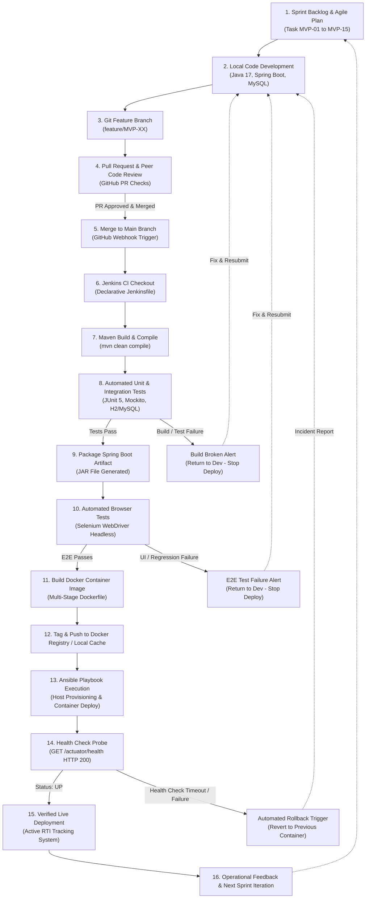

# DevOps Delivery Workflow & Architecture

**Document Version:** 1.0.0-PROPOSED  
**Baseline Reference:** [task-01-problem-definition.md](task-01-problem-definition.md) | [task-02-agile-planning.md](task-02-agile-planning.md)  
**Status:** DevOps Lifecycle Baseline (Academic Architecture)  
**Date:** October 14, 2026  

---

## 1. End-to-End DevOps Lifecycle Pipeline

The diagram below outlines the complete lifecycle from developer iteration to automated quality gates, artifact packaging, containerization, deployment orchestration, and health telemetry feedback.



---

## 2. Core Differences: Continuous Integration vs. Continuous Deployment

To maintain academic rigor and clarity, the pipeline establishes a strict conceptual separation between Continuous Integration (CI) and Continuous Deployment (CD):

| Dimension | Continuous Integration (CI) | Continuous Deployment (CD) |
|---|---|---|
| **Scope** | Stages 5 through 11 in the pipeline diagram. | Stages 12 through 15 in the pipeline diagram. |
| **Primary Goal** | Validate code correctness, code health, test coverage, and packaging reproducibility. | Automate environment provisioning, image delivery, service deployment, and runtime health verification. |
| **Trigger Mechanism** | Triggered automatically on every Git push or Pull Request merge to GitHub. | Triggered only after all CI stages and automated Selenium regression gates pass cleanly. |
| **Tooling Used** | Git, GitHub, Maven, JUnit 5, Mockito, Selenium WebDriver, Jenkins, Docker build. | Docker Registry/Daemon, Ansible Playbooks, Spring Boot Actuator health probes, rollback scripts. |
| **Failure Behavior** | Fails the Jenkins pipeline build; notifies the developer team; halts artifact publication. | Halts deployment on target host; preserves the previous working container or initiates automatic container rollback. |

---

## 3. Detailed Explanation of Lifecycle Stages

### Stage 1: Agile Planning & User Story Selection
Work items originate from the frozen 15-task backlog in [product-backlog.md](product-backlog.md). Tasks satisfying the Definition of Ready are scheduled into the active sprint.

### Stage 2: Code Construction
Developers write Spring Boot application code (Controllers, Services, JPA Entities, Thymeleaf/HTML views) in compliance with architectural layering rules.

### Stage 3 & 4: Git Feature Branching & Peer Review
All modifications occur on isolated feature branches (`feature/MVP-XX`). Merging into `main` requires a GitHub Pull Request (PR) accompanied by at least one peer approval, verifying adherence to coding and testability guidelines.

### Stage 5 & 6: Main Merge & Jenkins Checkout
Merging the PR to `main` triggers a GitHub webhook that initiates a Jenkins build on the CI server. The Declarative `Jenkinsfile` checks out the exact Git commit SHA.

### Stage 7: Maven Build & Compilation
Maven compiles the codebase using `mvn clean compile`, ensuring language compatibility with Java 17 and validating all project dependencies specified in `pom.xml`.

### Stage 8: Automated Unit & Integration Testing
Maven Surefire executes JUnit 5 and Mockito tests. This stage verifies:
- Input validation constraints (email formatting, string boundaries, file extension restrictions).
- Uniqueness and collision resistance of tracking ID generation algorithms.
- State-machine transition rules and chronological history recording.
- **Test Failure Branch:** Any test assertion failure immediately marks the Jenkins build as `FAILED`, stops pipeline execution, and returns the issue to the development team.

### Stage 9: Artifact Packaging
Upon passing all unit/integration tests, Maven packages the deployable fat JAR file (`mvn package -DskipTests`).

### Stage 10: Automated Browser Testing (Selenium WebDriver)
Prior to containerization, an automated functional test suite launches a headless Chrome browser instance. Selenium executes end-to-end user journeys:
1. Citizen fills out the submission form and submits.
2. Selenium extracts the generated Tracking ID from the DOM (`#tracking-id-display`).
3. Selenium queries the tracking page and verifies initial status is `SUBMITTED`.
4. Selenium logs into the reviewer dashboard, selects the request, updates status to `APPROVED` with remarks, and verifies the timeline updates.
- If any UI selector breaks or assertion fails, the pipeline halts immediately.

### Stage 11 & 12: Docker Containerization & Registry Staging
A multi-stage `Dockerfile` uses an optimized JRE base image to minimize footprint and attack surface. The built container image is tagged with the Git commit hash and staged in the Docker registry or local image cache.

### Stage 13: Ansible Configuration Management & Deployment
Ansible playbooks execute on target hosts:
- Ensure Docker daemon and network configurations are present.
- Stop and gracefully remove deprecated application containers.
- Launch the updated application container linked to the MySQL database container.

### Stage 14: Automated Health Check Verification & Rollback
Immediately post-deployment, an automated verification step polls the application endpoint:
```http
GET http://<host>:8080/actuator/health
```
- **Success Criteria:** HTTP 200 OK with `{"status":"UP"}` returned within 30 seconds.
- **Rollback Behavior:** If the health probe fails or times out, Ansible executes a rollback handler to reinstate the previous known-good container image and alerts the DevOps team.

### Stage 15 & 16: Operational Monitoring & Feedback Loop
Once health is validated, the release is deemed active. Telemetry, error logs, and evaluator feedback are reviewed during the Sprint Retrospective to guide the next iteration.
