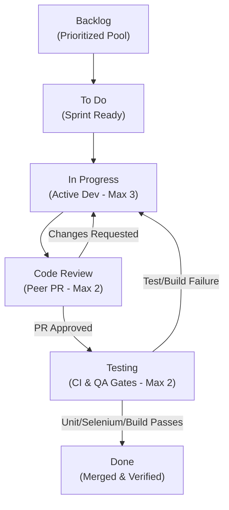

# Kanban Board: Jenkins-Based RTI Request Tracking System

**Document Version:** 1.0.0-PROPOSED  
**Baseline Reference:** [task-01-problem-definition.md](task-01-problem-definition.md) | [product-backlog.md](product-backlog.md)  
**Status:** Initial Project State (No development underway)  
**Date:** October 14, 2026  

---

## 1. Kanban Workflow State Machine

The workflow represents the path of every implementation task from initial ideation through production verification. Failed peer reviews or failed automated pipeline tests **must** be sent back to the `In Progress` development column with logged remediation comments.

---

## 2. Work-in-Progress (WIP) Limits and Column Transition Policies

| Column | WIP Limit | Entry Criteria | Exit / Transition Rules |
|---|---|---|---|
| **Backlog** | $\infty$ | Scope agreed in Task 1 baseline. | Item satisfies Definition of Ready (DoR) and is pulled into the current sprint. |
| **To Do** | 5 | Prioritized item assigned to current sprint iteration. | Developer pulls an item when ready to begin active coding. |
| **In Progress** | 3 | Developer creates feature branch `feature/MVP-XX` from `main`. | Code is complete, unit tests pass locally, and Pull Request (PR) is opened. |
| **Code Review** | 2 | PR submitted on GitHub with linked issue and clean diff. | Approved by at least one peer reviewer. If changes are requested, card moves back to `In Progress`. |
| **Testing** | 2 | PR merged to test branch or Jenkins CI trigger fires. | Jenkins CI passes (build, unit tests, Selenium tests, Docker image verification). On failure, card returns to `In Progress`. |
| **Done** | $\infty$ | Satisfies all Definition of Done (DoD) criteria. | Milestone signed off by Product Owner / Faculty Evaluator. |

---

## 3. Initial Kanban Board Snapshot

As of project initiation, no code has been generated and no pipeline executions have occurred. All 15 MVP tasks reside in either **Backlog** or **To Do** (staged for Sprint 1). Columns for active work remain strictly empty.

| Backlog (WIP: $\infty$) | To Do (WIP: 5) | In Progress (WIP: 3) | Code Review (WIP: 2) | Testing (WIP: 2) | Done (WIP: $\infty$) |
|---|---|---|---|---|---|
| **MVP-04**: Request Submission Service & Validation  **MVP-05**: Unique Tracking ID Generation Logic  **MVP-06**: Public Status Tracking & Audit History Service  **MVP-07**: Reviewer Workflow & State Transition Engine  **MVP-08**: Expose Actuator / Health Check Endpoints  **MVP-09**: Citizen Web UI (Submission & Search)  **MVP-10**: Reviewer Dashboard UI with Action Modals  **MVP-11**: Unit & Integration Test Suite  **MVP-12**: Selenium WebDriver E2E Test Suite  **MVP-13**: Multi-Stage Dockerfiles & Compose Manifests  **MVP-14**: Declarative Jenkinsfile for CI Pipeline  **MVP-15**: Ansible Deployment Playbooks | **MVP-01**: Initialize Maven Project Structure & Dependencies  **MVP-02**: Design Relational Schema & Database Migrations  **MVP-03**: Implement Core Domain Entities & Repository Layer | *(Empty)* | *(Empty)* | *(Empty)* | *(Empty)* |

---

## 4. Bottleneck Remediation and Governance Rules

1. **WIP Limit Adherence:** If the `In Progress` column hits its limit of 3, team members cannot pull new tasks from `To Do`. Instead, developers must assist with open Code Reviews or investigate pipeline failures in `Testing`.
2. **Defect & Failure Priority:** Any card returned to `In Progress` due to a broken build or failed Selenium run automatically takes precedence over normal sprint development.
3. **Traceability Rule:** Every branch, commit message, and PR must explicitly reference the stable Task ID (e.g., `feat(MVP-01): configure spring boot pom.xml`).
