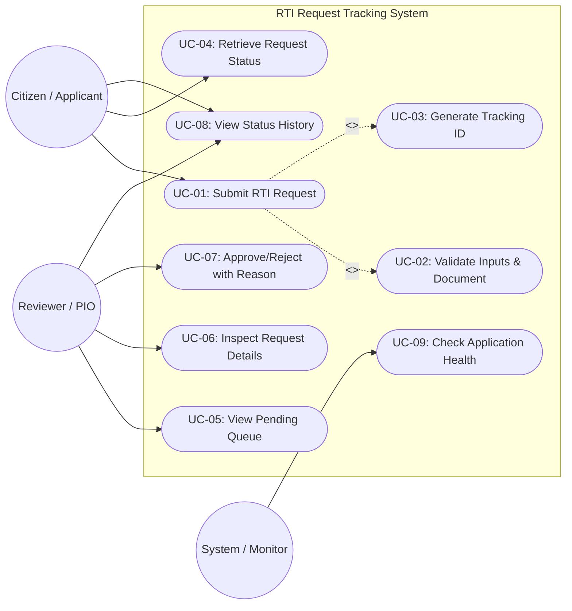
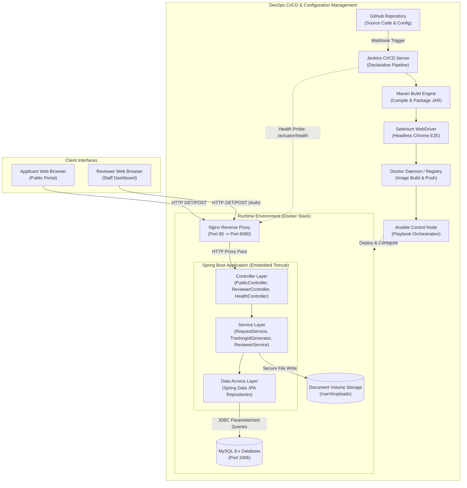
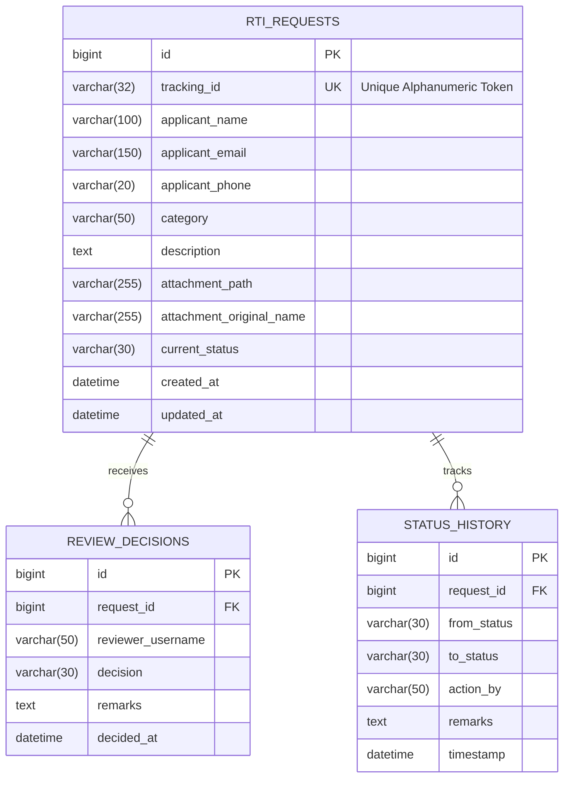

# Faculty Task 3: Software Requirements, System Architecture, and Technology Setup

**Project Title:** Jenkins-Based RTI Request Tracking System  
**Document Version:** 1.0.0-PROPOSED  
**Baseline References:**
- [task-01-problem-definition.md](task-01-problem-definition.md)
- [task-02-agile-planning.md](task-02-agile-planning.md)
- [product-backlog.md](product-backlog.md)
- [kanban-board.md](kanban-board.md)
- [sprint-plan.md](sprint-plan.md)
- [devops-workflow.md](devops-workflow.md)

**Status:** Architecture and Technical Setup Baseline (Academic Project)  
**Date:** October 14, 2026  

---

## 1. Software Requirements Specification (SRS) Summary

### 1.1 Purpose, Scope, Stakeholders, and System Boundary
- **Purpose:** This specification defines the software requirements, relational schema, architectural topologies, API endpoints, and development setup for the **Jenkins-Based RTI Request Tracking System**. It bridges the conceptual planning of Tasks 1 & 2 with the technical execution phases.
- **Scope & System Boundary:** The software simulates a public Right to Information (RTI) administrative tracking lifecycle. It is strictly an **isolated academic simulation** hosted on private, containerized local infrastructure. It does **not** interface with official government portals (such as `rtionline.gov.in`), does not process real public funds or legal requests, and does not retain sensitive personal data.
- **Key Stakeholders:**
  - *Citizen / Applicant:* Submits simulated inquiries, receives unique tracking tokens, and tracks status.
  - *Public Information Officer (Reviewer / Admin):* Authenticates to review queues, inspects submissions, and logs administrative decisions with remarks.
  - *DevOps Team (Students):* Builds, containerizes, tests, and automates deployment through Jenkins and Ansible.
  - *Faculty / Evaluator:* Evaluates code quality, pipeline execution logs, test coverage, and architecture compliance.

### 1.2 Functional Requirements (FR)

| Req ID | Requirement Name | Description | Traceable MVP Task |
|---|---|---|---|
| **FR-01** | Public Request Submission | The system shall provide a public web form allowing citizens to file an RTI request with applicant name, email, phone number, subject category, and narrative request text (20–2,000 characters). | MVP-04, MVP-09 |
| **FR-02** | Supporting Attachment Ingestion | The system shall permit the applicant to upload an optional single supporting document in `.pdf`, `.png`, or `.jpg` format not exceeding 2 MB. | MVP-04, MVP-09 |
| **FR-03** | Server-Side Input Validation | The system shall validate email format, numeric phone format, character length restrictions, and file extension/MIME types, returning structured field-level errors on validation failure. | MVP-04 |
| **FR-04** | Collision-Free Tracking ID Generation | Upon successful persistence of an application, the system shall generate a deterministic, unique tracking identifier formatted as `RTI-YYYY-XXXXXX` and return it immediately to the user. | MVP-05 |
| **FR-05** | Public Status Inquiry | The system shall allow anyone with a valid Tracking ID to query the current status (`SUBMITTED`, `UNDER_REVIEW`, `APPROVED`, `REJECTED`, `CLOSED`), submission timestamp, subject category, and public remarks without exposing the applicant's contact details. | MVP-06, MVP-09 |
| **FR-06** | Chronological Status Audit Trail | The system shall maintain an immutable chronological history of all state changes for each request, recording transition timestamp, prior state, new state, responsible actor/role, and review remarks. | MVP-06 |
| **FR-07** | Reviewer Authentication & Queue Display | The system shall restrict reviewer features behind an authenticated session and display a tabular queue of pending requests filterable by status. | MVP-07, MVP-10 |
| **FR-08** | Reviewer Decision & Remarks Enforcement | The system shall permit authenticated reviewers to transition requests from `SUBMITTED` to `UNDER_REVIEW`, and subsequently to `APPROVED` or `REJECTED`, requiring mandatory remarks ($\ge$ 10 characters) before committing the change. | MVP-07, MVP-10 |
| **FR-09** | Application Health Telemetry | The system shall expose an unauthenticated diagnostic endpoint (`/actuator/health`) reporting overall application readiness and database connectivity status. | MVP-08 |

### 1.3 Non-Functional Requirements (NFR)

| Req ID | Requirement Category | Metric / Specification | Traceable MVP Task |
|---|---|---|---|
| **NFR-01** | Security: SQL Injection & XSS | 100% of database interactions shall use parameterized Spring Data JPA queries; all web views shall escape HTML entities. | MVP-03, MVP-04 |
| **NFR-02** | Security: Role Boundary | Public tracking endpoints must never expose applicant phone numbers, email addresses, or physical addresses; administrative reviewer endpoints must reject unauthenticated requests. | MVP-06, MVP-07 |
| **NFR-03** | Maintainability & Layering | Code must follow strict 3-tier layering (Controller $\rightarrow$ Service $\rightarrow$ Repository) with zero business logic implemented in JPA entities or web controllers. | MVP-01, MVP-03 |
| **NFR-04** | Testability & Coverage | Service and domain logic shall achieve $\ge$ 70% line coverage in unit tests; all interactive HTML elements must bear stable DOM `id` attributes for Selenium test selectors. | MVP-11, MVP-12 |
| **NFR-05** | Reliability & Atomicity | State transitions and status history insertions shall execute inside atomic database transactions (`@Transactional`). | MVP-07 |
| **NFR-06** | Container Portability | The application and database must build and launch via standard Docker Compose manifests on any host running Docker Engine 24+ without host-specific configuration files. | MVP-13 |
| **NFR-07** | Deployment Idempotency | Ansible playbooks must run repeatedly with zero unintentional state drift (`changed=0` on clean rerun). | MVP-15 |

### 1.4 Assumptions, Constraints, Dependencies, and Risks
- **Constraints:** Java 17 LTS, Spring Boot 3.x, Maven 3.8+, MySQL 8.x, Jenkins LTS, Docker & Docker Compose, Selenium WebDriver, and Ansible.
- **Assumptions:** Maximum concurrent users $< 50$ (academic evaluation scope); reviewer credentials pre-seeded into database or application configuration.
- **Dependencies:** Available Docker daemon on the build/deployment host; headless Google Chrome installation for Selenium test execution in the Jenkins pipeline agent.
- **Risks:** Flaky headless browser execution in CI agents (mitigated by explicit Selenium wait conditions); Ansible execution on Windows hosts (mitigated by targeting Linux containers/WSL2).

---

## 2. System Use Cases

### 2.1 Use Case Specifications

1. **UC-01: Submit an RTI Request (Applicant)**  
   The applicant accesses the web form, enters personal details, subject category, narrative description, and optionally uploads a supporting document ($\le$ 2 MB). The system validates the payload, generates an `RTI-YYYY-XXXXXX` tracking token, persists the entity in `SUBMITTED` state, and presents the tracking ID.
2. **UC-02: Validate Request Fields and Document Metadata (System)**  
   On submission, the system validates constraints: name not blank, email conforming to RFC 5322, phone containing 10 digits, description between 20 and 2,000 characters, file extension in `{.pdf, .png, .jpg}`, and file size $\le$ 2,097,152 bytes. Invalid inputs return HTTP 400 with field-level error messages.
3. **UC-03: Generate Tracking ID (System)**  
   A thread-safe generator creates an alphanumeric token combining prefix `RTI`, current year `YYYY`, and a collision-resistant 6-character sequence. Uniqueness is enforced at both service and database constraint levels.
4. **UC-04: Retrieve Request Status (Applicant / Public)**  
   A user submits a Tracking ID via the public search view. The system retrieves the record and renders the current state (`SUBMITTED`, `UNDER_REVIEW`, `APPROVED`, `REJECTED`), filing timestamp, subject category, and public remarks. Personal contact information is filtered out.
5. **UC-05: View Pending Requests (Reviewer)**  
   An authenticated reviewer accesses the dashboard. The system displays a tabular queue of all requests whose state is `SUBMITTED` or `UNDER_REVIEW`, ordered by submission timestamp ascending (FIFO).
6. **UC-06: Inspect Request Details (Reviewer)**  
   The reviewer selects an individual request from the queue. The system displays full submission details, applicant contact information, and provides a download/view link for the uploaded supporting document.
7. **UC-07: Approve or Reject a Request with Reason (Reviewer)**  
   The reviewer selects an action (`APPROVE` or `REJECT`) and provides mandatory justification remarks ($\ge$ 10 characters). The system transitions the request to `APPROVED` or `REJECTED`, sets the resolution timestamp, and records an audit log entry.
8. **UC-08: View Status History (Applicant / Reviewer)**  
   The system queries `request_status_history` by request ID and presents a chronological timeline depicting every lifecycle state transition with timestamps, actor role, and associated remarks.
9. **UC-09: Check Application Health (System / Monitor / Pipeline)**  
   A health probe (cURL or pipeline step) issues an HTTP GET to `/actuator/health`. The system queries MySQL and internal components, responding with HTTP 200 `{"status":"UP"}` when operational.

### 2.2 Mermaid Use-Case Diagram



---

## 3. System Architecture

### 3.1 Architectural Decomposition

The application adopts a classic **Three-Tier Layered Architecture** fronted by an **Nginx Reverse Proxy**:
1. **Presentation Layer (Web / Reverse Proxy):** Nginx serves as the reverse proxy on port 80/443, routing traffic, terminating TLS (if configured), serving static assets, and forwarding application traffic to the internal Spring Boot application server running on port 8080.
2. **Application Layer (Spring Boot / Embedded Tomcat):**
   - **REST / Web Controllers:** Maps incoming HTTP requests, performs initial DTO binding, and handles session/role authorization.
   - **Service Layer:** Implements business rules, input/file validation logic, tracking ID generation, and transactional state-machine management.
   - **Repository / Data Access Layer:** Spring Data JPA / Hibernate abstractions executing parameterized SQL queries against MySQL.
3. **Persistence Layer (MySQL 8.x):** Relational database storing requests, status audit history, and user credentials.
4. **DevOps & Automation Pipeline:** Jenkins coordinates build, test, containerization, and deployment stages; Selenium performs automated UI validation; Docker packages reproducible container images; Ansible automates host provisioning and deployment.

### 3.2 Mermaid Component and Architecture Diagram



---

## 4. Relational Data Model

To satisfy the functional requirements while preventing over-engineering, the system uses a compact, normalized relational schema consisting of three primary tables: `rti_requests`, `review_decisions`, and `status_history`.

### 4.1 Schema Definition & Data Dictionary

#### 1. Table: `rti_requests`
Stores initial request filings and core application metadata.
- `id` (BIGINT, Primary Key, Auto-Increment)
- `tracking_id` (VARCHAR(32), NOT NULL, UNIQUE, Indexed) — User-facing token (`RTI-YYYY-XXXXXX`).
- `applicant_name` (VARCHAR(100), NOT NULL)
- `applicant_email` (VARCHAR(150), NOT NULL, Indexed)
- `applicant_phone` (VARCHAR(20), NOT NULL)
- `category` (VARCHAR(50), NOT NULL) — Subject classification (e.g., `ACADEMIC`, `ADMINISTRATIVE`, `INFRASTRUCTURE`, `FINANCIAL`).
- `description` (TEXT, NOT NULL) — Detailed information request (20 to 2,000 chars).
- `attachment_path` (VARCHAR(255), NULL) — Relative filesystem path of uploaded document.
- `attachment_original_name` (VARCHAR(255), NULL) — Original filename of uploaded document.
- `current_status` (VARCHAR(30), NOT NULL, Default: `'SUBMITTED'`) — Values: `SUBMITTED`, `UNDER_REVIEW`, `APPROVED`, `REJECTED`, `CLOSED`.
- `created_at` (DATETIME, NOT NULL, Default: `CURRENT_TIMESTAMP`)
- `updated_at` (DATETIME, NOT NULL, Default: `CURRENT_TIMESTAMP ON UPDATE CURRENT_TIMESTAMP`)

#### 2. Table: `review_decisions`
Stores administrative reviewer decisions and justifications.
- `id` (BIGINT, Primary Key, Auto-Increment)
- `request_id` (BIGINT, NOT NULL, Foreign Key $\rightarrow$ `rti_requests(id)`)
- `reviewer_username` (VARCHAR(50), NOT NULL) — Identifier of the administrative reviewer.
- `decision` (VARCHAR(30), NOT NULL) — Values: `UNDER_REVIEW`, `APPROVED`, `REJECTED`.
- `remarks` (TEXT, NOT NULL) — Mandatory explanation or justification.
- `decided_at` (DATETIME, NOT NULL, Default: `CURRENT_TIMESTAMP`)

#### 3. Table: `status_history`
Stores an immutable, append-only chronological log of all lifecycle transitions.
- `id` (BIGINT, Primary Key, Auto-Increment)
- `request_id` (BIGINT, NOT NULL, Foreign Key $\rightarrow$ `rti_requests(id)`)
- `from_status` (VARCHAR(30), NULL) — Prior state (`NULL` for initial submission).
- `to_status` (VARCHAR(30), NOT NULL) — New state.
- `action_by` (VARCHAR(50), NOT NULL) — Actor or system role (`APPLICANT`, `REVIEWER:username`, `SYSTEM`).
- `remarks` (TEXT, NULL) — Context or explanation for the transition.
- `timestamp` (DATETIME, NOT NULL, Default: `CURRENT_TIMESTAMP`)

### 4.2 Entity Relationship Diagram (Mermaid)



---

## 5. REST API Specification

### 5.1 Endpoints Overview

| Method | Endpoint | Access Level | Description |
|---|---|---|---|
| `POST` | `/api/v1/requests` | Public | Submits a new RTI application (multipart form). |
| `GET` | `/api/v1/requests/track/{trackingId}` | Public | Looks up status & sanitized history by Tracking ID. |
| `GET` | `/api/v1/reviewer/requests` | Authenticated (Reviewer) | Retrieves pending/active request queue. |
| `GET` | `/api/v1/reviewer/requests/{id}` | Authenticated (Reviewer) | Retrieves full request details including applicant info. |
| `POST` | `/api/v1/reviewer/requests/{id}/decision` | Authenticated (Reviewer) | Records an approval or rejection with remarks. |
| `GET` | `/actuator/health` | Public / Monitor | System and database diagnostic probe. |

### 5.2 Endpoint Details and Payloads

#### 1. Submit Request
- **Endpoint:** `POST /api/v1/requests`
- **Content-Type:** `multipart/form-data`
- **Parameters:**
  - `applicantName` (string, required)
  - `applicantEmail` (string, required, valid email format)
  - `applicantPhone` (string, required, 10 digits)
  - `category` (string, required)
  - `description` (string, required, 20–2,000 characters)
  - `attachment` (file, optional, PDF/PNG/JPG $\le$ 2 MB)
- **Response (201 Created):**
```json
{
  "success": true,
  "trackingId": "RTI-2026-A8F93B",
  "status": "SUBMITTED",
  "submittedAt": "2026-10-14T23:30:00Z",
  "message": "Your RTI request has been submitted successfully. Please save your Tracking ID for future status inquiries."
}
```
- **Error Response (400 Bad Request):**
```json
{
  "success": false,
  "errorCode": "VALIDATION_FAILED",
  "errors": {
    "applicantEmail": "Must be a well-formed email address",
    "description": "Description must be between 20 and 2000 characters"
  }
}
```

#### 2. Public Status Lookup
- **Endpoint:** `GET /api/v1/requests/track/{trackingId}`
- **Security Rule:** Applicant contact details (email, phone, address) are **strictly omitted** from this response to preserve privacy in a public endpoint.
- **Response (200 OK):**
```json
{
  "trackingId": "RTI-2026-A8F93B",
  "category": "INFRASTRUCTURE",
  "status": "UNDER_REVIEW",
  "submittedAt": "2026-10-14T23:30:00Z",
  "history": [
    {
      "fromStatus": null,
      "toStatus": "SUBMITTED",
      "timestamp": "2026-10-14T23:30:00Z",
      "remarks": "Application submitted by applicant"
    },
    {
      "fromStatus": "SUBMITTED",
      "toStatus": "UNDER_REVIEW",
      "timestamp": "2026-10-15T09:15:00Z",
      "remarks": "Assigned to Public Information Officer for document verification"
    }
  ]
}
```
- **Error Response (404 Not Found):**
```json
{
  "success": false,
  "errorCode": "REQUEST_NOT_FOUND",
  "message": "No RTI request found matching tracking identifier RTI-2026-000000"
}
```

#### 3. Reviewer Queue & Decisions
- **Protection:** Endpoints under `/api/v1/reviewer/**` are secured using Spring Security requiring authenticated session with role `ROLE_REVIEWER`.
- **Decision Request:** `POST /api/v1/reviewer/requests/{id}/decision`
```json
{
  "decision": "APPROVED",
  "remarks": "Information requested verified against university records. Response document dispatched."
}
```
- **Response (200 OK):**
```json
{
  "success": true,
  "requestId": 1,
  "trackingId": "RTI-2026-A8F93B",
  "newStatus": "APPROVED",
  "updatedAt": "2026-10-15T11:45:00Z"
}
```

#### 4. Health Check
- **Endpoint:** `GET /actuator/health`
- **Response (200 OK):**
```json
{
  "status": "UP",
  "components": {
    "db": {
      "status": "UP",
      "details": {
        "database": "MySQL",
        "validationQuery": "isValid()"
      }
    },
    "diskSpace": {
      "status": "UP"
    }
  }
}
```

---

## 6. Technology Decisions and Architectural Justification

| Technology | Selection Rationale for College DevOps Project |
|---|---|
| **Java 17 LTS & Spring Boot 3.x** | Industry standard, robust dependency injection, strong type safety, built-in validation annotations (`jakarta.validation`), and embedded Tomcat runtime eliminating standalone web container management. |
| **Apache Maven** | Standardized project lifecycle (`compile`, `test`, `package`), declarative plugin management, native Jenkins integration, and straightforward Surefire/JaCoCo report generation. |
| **MySQL 8.x** | Production-grade relational database with strict ACID compliance, transactional integrity for status audit trails, and official Docker container images. |
| **Git & GitHub** | Distributed version control enabling feature-branch workflows (`feature/MVP-XX`), pull-request code reviews, and webhook triggers into Jenkins. |
| **Jenkins LTS** | Leading open-source automation server supporting pipeline-as-code (`Jenkinsfile`), rich plugin ecosystem, and clear visual build execution steps. |
| **Selenium WebDriver** | Headless automated browser testing that validates real DOM elements, client validation alerts, and end-to-end user journeys in CI before packaging. |
| **Docker & Docker Compose** | Solves "works on my machine" issues by encapsulating runtime dependencies into multi-stage, immutable container images and orchestrating multi-container stacks (App + MySQL). |
| **Nginx Reverse Proxy** | Production-style ingress proxy handling port 80 routing, buffering, static file serving, and isolating the internal application container. |
| **Ansible** | Agentless configuration management and deployment automation using human-readable YAML playbooks to provision Docker hosts and run health checks idempotently. |

---

## 7. Local Development Setup and Environment Verification

### 7.1 PowerShell Commands for Environment Verification

Before starting development or testing on the host Windows machine, verify all prerequisite tooling using PowerShell:

```powershell
# 1. Verify Java 17 LTS
java -version

# 2. Verify Apache Maven
mvn -version

# 3. Verify Git
git --version

# 4. Verify Docker Engine & Compose
docker --version
docker compose version

# 5. Verify WSL (Windows Subsystem for Linux - for Ansible runtime)
wsl --status
wsl --list --verbose

# 6. Check if Jenkins is accessible locally (if running on port 8080)
Test-NetConnection -ComputerName localhost -Port 8080
```

### 7.2 Database Configuration and Secrets Management
- The application connects to MySQL via Spring Data JPA using externalized environment variables to avoid committing credentials to Git:
  - `SPRING_DATASOURCE_URL`: `jdbc:mysql://${DB_HOST:localhost}:${DB_PORT:3306}/${DB_NAME:rti_db}?createDatabaseIfNotExist=true&useSSL=false&serverTimezone=UTC`
  - `SPRING_DATASOURCE_USERNAME`: `${DB_USER:rti_user}`
  - `SPRING_DATASOURCE_PASSWORD`: `${DB_PASSWORD:CHANGE_ME_IN_ENV}`
- Placeholders such as `CHANGE_ME_IN_ENV` or `<SECURE_PASSWORD>` must always be used in documentation and template files.

### 7.3 Local Build and Run Procedure
```powershell
# Compile and run unit tests locally
mvn clean test

# Package the executable Spring Boot JAR
mvn clean package -DskipTests

# Run the Spring Boot application locally (with local MySQL or H2 test profile)
$env:DB_HOST="localhost"
$env:DB_PORT="3306"
$env:DB_NAME="rti_db"
$env:DB_USER="rti_user"
$env:DB_PASSWORD="<SECURE_PASSWORD>"
java -jar target/rti-tracking-system-1.0.0.jar
```

### 7.4 Ansible Control Environment Notice
> **Note on Ansible:** Ansible requires a POSIX-compliant environment and cannot run natively as an Ansible Control Node on Windows. For local orchestration, Ansible playbooks must be executed via **WSL2 (Ubuntu)** or via an **Ansible Docker container**. Deployment target IP addresses and container sockets will be validated during Task 4/5 environment setup.

---

## 8. Security and Deployment Considerations

1. **Input Sanitization & Injection Prevention:**
   - Database queries leverage Spring Data JPA repository methods (compiled to parameterized JDBC PreparedStatement), mitigating SQL injection.
   - Narrative text fields and reviewer remarks are rendered with HTML escaping to prevent stored XSS attacks.
2. **File Upload Hardening:**
   - Uploaded files are validated against allowed MIME types (`application/pdf`, `image/png`, `image/jpeg`).
   - Files are renamed upon disk storage to UUID-based identifiers (e.g., `uploads/{uuid}.pdf`), neutralizing directory traversal attacks (`../../etc/passwd`).
   - Upload directory is placed outside the web-accessible root.
3. **Reviewer Authorization:**
   - Administrative review endpoints require HTTP Basic or Form-based authentication.
   - Public tracking lookups strictly exclude applicant personal identifiers (email, phone, home address).
4. **Health Checks & Monitoring:**
   - Spring Boot Actuator `/actuator/health` provides continuous liveness and readiness signals.
5. **Rollback & Disaster Recovery:**
   - In the event of a failed deployment or unhealthy status probe, Ansible or Docker Compose can immediately restart the previous container tag (`latest_stable`).
   - Relational database volume (`mysql-data`) is mounted on a persistent Docker volume separate from container lifecycles.
6. **Academic Simulation Notice:**
   - The application is an educational simulation. No actual administrative decisions are legally binding under national RTI acts.
